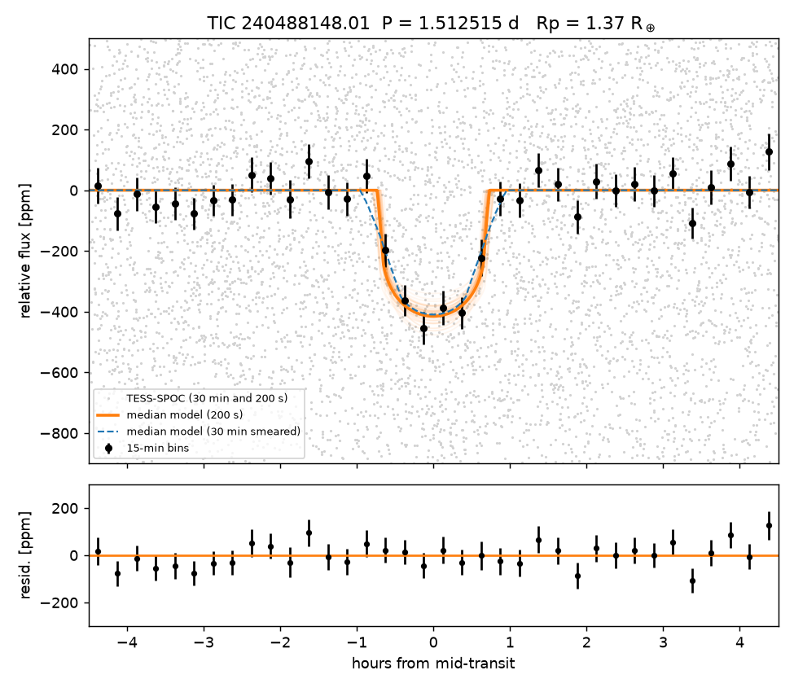

## A 1.4 Earth-radius, 1.51-day transiting planet candidate around the nearby K dwarf TIC 240488148

**Advait Paliwal** (independent researcher) — advaitpaliwal@gmail.com

### Abstract

We report a transit-like signal on TIC 240488148 (TYC 3191-503-1), a K dwarf at 58.7 pc, found in TESS full-frame-image photometry from six sectors spanning 2019–2024. A transit model fit gives a period of 1.5125149 ± 0.0000029 d, a depth of 411 ± 28 ppm and a duration of 1.41 h, which implies a planet radius of 1.37 ± 0.14 Earth radii. It is not on the TOI, CTOI or NASA Exoplanet Archive lists, and the SPOC pipeline never produced a report for the star. The signal appears in every sector and in two independent pipelines, with matching odd and even depths and no secondary eclipse. Difference images and TESS-Localize exclude every catalogued neighbour beyond 11″ as the source. TRICERATOPS gives a nearby false-positive probability of about 7 × 10⁻⁹ once those neighbours are excluded. The overall false-positive probability is 0.081 without companion constraints and 0.024 with Gaia-based limits from MOLUSC. Both are above the 0.015 validation threshold, so the candidate is not validated. High-resolution imaging would test the remaining unresolved-companion scenarios.

### Star

| Quantity | Value | Source |
|---|---|---|
| RA, Dec (J2000) | 323.62829°, +42.64403° | TIC v8.2 |
| TESS magnitude | 10.17 | TIC v8.2 |
| Distance | 58.7 pc | TIC v8.2 / Gaia DR3 |
| Effective temperature | 4403 ± 127 K | TIC v8.2 |
| Radius, mass | 0.672 ± 0.057 R☉, 0.690 ± 0.083 M☉ | TIC v8.2 |
| Gaia DR3 RUWE | 1.039 | Gaia DR3 |
| Gaia radial velocity | −44.12 ± 0.18 km/s, constant across 32 epochs (p = 0.83) | Gaia DR3 |

No high-resolution imaging, reconnaissance spectroscopy or radial-velocity monitoring of the star is on ExoFOP. It has no entry in the Gaia DR3 non-single-star tables, LAMOST, RAVE, APOGEE, GALAH, WDS or the El-Badry et al. (2021) wide-binary catalogue.

### Data and search

The star has no TESS 2-minute data before Sector 56. We used the TESS-SPOC full-frame-image light curves (Caldwell et al. 2020) for Sectors 15, 16, 56, 76, 82 and 83: 30-minute cadence in Sectors 15–16 and 200-second cadence after that. The light curves were flattened with a 0.75-day window. The signal was found with Transit Least Squares (Hippke & Heller 2019) over 0.5–12 d, giving SDE 29.2. The star was one of 1,096 nearby K and M dwarfs with full-frame data only that were searched this way. A positive control, TOI-270, was recovered at the correct period by the same pipeline.

### Signal

| Parameter | Value |
|---|---|
| Period | 1.5125149 ± 0.0000029 d |
| Transit midpoint | BJD_TDB 2460393.3435 (+0.0015 / −0.0012) |
| Depth (model, maximum) | 411 ± 28 ppm |
| Duration | 1.41 (+0.07 / −0.06) h |
| Radius ratio Rp/R★ | 0.0187 ± 0.0009 |
| a/R★ | 7.6 (+0.5 / −0.8) |
| Impact parameter | 0.42 (+0.18 / −0.24) |
| Planet radius | 1.37 (+0.14 / −0.13) R⊕ |
| Semi-major axis | 0.0228 ± 0.0009 AU |
| Insolation | 294 (+32 / −27) S⊕ |
| Equilibrium temperature | 1133 (+68 / −51) K (zero albedo, full redistribution) |
| Box-fit depth, TESS-SPOC / QLP | 374 ± 29 ppm (12.9σ) / 412 ± 33 ppm (12.4σ) |

The model was fitted with batman (Kreidberg 2015) and emcee (Foreman-Mackey et al. 2013) to 10,263 points within 4.5 h of transit, after detrending out-of-transit flux with wotan (Hippke et al. 2019). Exposures were supersampled (30 min in Sectors 15–16, 200 s after). We assumed a circular orbit, a TIC stellar-density prior and quadratic limb darkening from Claret (2017). The stellar density implied by the transit, 3.6 ± 0.9 g cm⁻³, agrees with the TIC value of 3.2 ± 1.0 g cm⁻³. Box-fit depths per sector in TESS-SPOC data are 337 ± 91, 230 ± 73, 413 ± 57, 438 ± 90, 433 ± 59 and 340 ± 81 ppm. The combined fit has χ² = 6.2 for 5 degrees of freedom. The QLP light curves (Huang et al. 2020a,b; Kunimoto et al. 2021) reproduce the signal in all five sectors they cover. Odd and even transits differ by 0.67σ. The depth at phase 0.5 is 30 ± 23 ppm. Folding at half the period gives half the depth, and folding at twice the period gives the same depth, so the period is the one stated. Centroid shifts are under 6.3 mas in every sector, with no consistent direction.

### Ruling out neighbouring stars

We made difference images, in transit minus out of transit, from cutouts from the MAST TESScut service (Brasseur et al. 2019) for Sectors 15, 16 and 83. In Sectors 15 and 83 the in-transit flux deficit sits on the target. TIC 240488141 (Tmag 14.6, 46″ away) would need a 6.2% eclipse to produce the signal. At its position the measured deficit is consistent with zero, and placing the signal there is ruled out by Δχ² = 5,346 in Sectors 15–16 and Δχ² = 699 in Sector 83. In total, 26 catalogued stars between 11″ and 69″ are excluded at Δχ² > 25. TESS-Localize (Higgins & Bell 2023) gives TIC 240488141 a relative likelihood of zero in all six sectors. Two faint stars (G ≈ 19) at 3.7″ and 7.3″ cannot be excluded from the pixels. Each would need an eclipse of about 70%, and TRICERATOPS assigns them negligible probability.

### False-positive probability

We used TRICERATOPS (Giacalone & Dressing 2020; Giacalone et al. 2021) with 10⁶ draws per run.

| Constraint | FPP | NFPP |
|---|---|---|
| None | 0.081 ± 0.003 | 0.0037 |
| Excluded neighbours removed | 0.076–0.083 | about 7 × 10⁻⁹ |
| MOLUSC companion limits (Wood et al. 2021) from Gaia RUWE and imaging | 0.0235 ± 0.0035 | 0.0040* |

\*This run did not remove the excluded neighbours.

The nearby false-positive probability is well under the 0.001 threshold. The overall false-positive probability is not under 0.015. Almost all of what remains comes from an unresolved bound companion that either dilutes a planet on the target or hosts the planet itself. Gaia cannot detect such companions inside about 0.7″. Collier et al. (2026) find that all validated planets smaller than 1.7 R⊕ in their imaging-bearing sample needed their contrast curves to pass, so we make no validation claim.

### Next steps

The candidate needs high-resolution speckle or adaptive-optics imaging to constrain close companions. The star (V ≈ 11, northern sky) suits seeing-limited photometry from the ground on a 1-metre-class telescope to confirm the transit is on target. With a predicted semi-amplitude of about 1.5–2 m/s for a rocky composition, precise radial velocities could measure its mass.

### Acknowledgements

This paper includes data collected by the TESS mission, funded by the NASA Science Mission Directorate, and obtained from MAST. It uses data from the ESA Gaia mission. Code and intermediate data are available on request.

### References

Brasseur, C. E., et al. 2019, ASCL, 1905.007 (TESScut) · Caldwell, D. A., et al. 2020, RNAAS, 4, 201 (TESS-SPOC) · Claret, A. 2017, A&A, 600, A30 · Collier, M., Giacalone, S., Derfer, B., et al. 2026, AAS Journals (accepted), arXiv:2608.21560 · El-Badry, K., Rix, H.-W., & Heintz, T. M. 2021, MNRAS, 506, 2269 · Foreman-Mackey, D., et al. 2013, PASP, 125, 306 · Gaia Collaboration, Vallenari, A., et al. 2023, A&A, 674, A1 · Giacalone, S., & Dressing, C. D. 2020, ascl:2002.004 · Giacalone, S., et al. 2021, AJ, 161, 24 · Higgins, M. E., & Bell, K. J. 2023, AJ, 165, 141 · Hippke, M., & Heller, R. 2019, A&A, 623, A39 · Hippke, M., et al. 2019, AJ, 158, 143 · Huang, C. X., et al. 2020a, RNAAS, 4, 204 (QLP) · Huang, C. X., et al. 2020b, RNAAS, 4, 206 · Kreidberg, L. 2015, PASP, 127, 1161 · Kunimoto, M., et al. 2021, RNAAS, 5, 234 · Lightkurve Collaboration 2018, ascl:1812.013 · Stassun, K. G., et al. 2019, AJ, 158, 138 (TIC) · Wood, M. L., et al. 2021, AJ, 161, 85 (MOLUSC)

*Figure 1 (`figure1_TIC240488148.png`): TESS-SPOC photometry from all six sectors folded on the fitted ephemeris, with 15-minute bins, the median transit model and residuals.*

